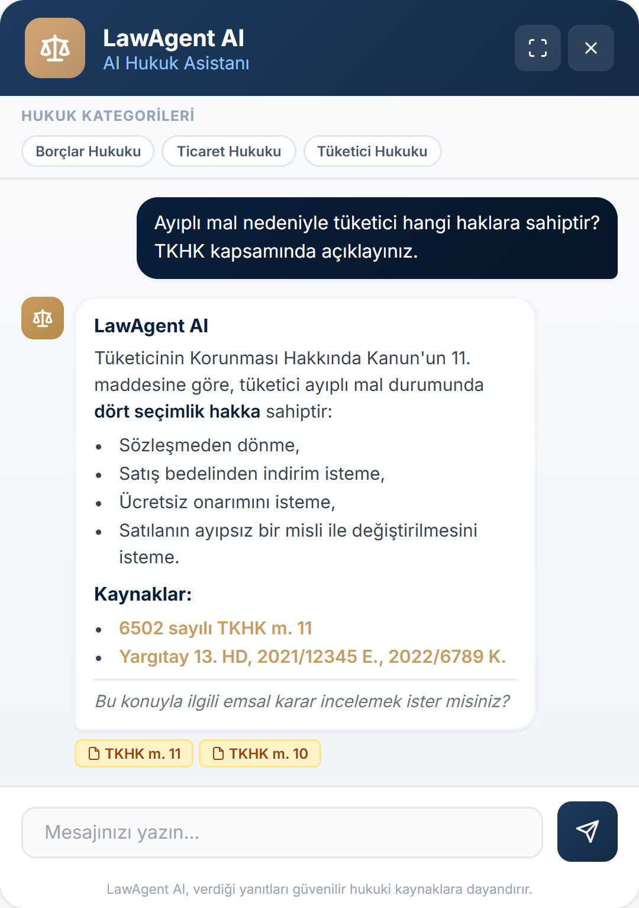

<div align="center">

# ⚖️ LawAgent AI

### Türk Hukuku için Hibrit RAG & Deterministik Atıf Sistemi

_Türk Borçlar Kanunu · Türk Ticaret Kanunu · Tüketici Koruma Kanunu · Yargıtay Emsal Kararları_

<br/>

[](https://www.python.org/)
[](https://fastapi.tiangolo.com/)
[](https://react.dev/)
[](https://vitejs.dev/)
[](https://tailwindcss.com/)
[](https://qdrant.tech/)
[](https://groq.com/)
[](https://www.docker.com/)
[](/.github/workflows/ci.yml)
[](https://hllerdgn-lawagent-backend.hf.space/health)
[](assets/docs/)

<br/>

[📐 Mimari](#-sistem-mimarisi) · [📸 Ekranlar](#-arayüz-görselleri) · [🚀 Kurulum](#-hızlı-başlangıç) · [📡 API](#-api-referansı) · [🧪 Test](#-test--ci) · [📦 Dizin](#-proje-dizin-yapısı)

</div>

---

## 📌 Proje Özeti

**LawAgent AI**, Türk hukuk mevzuatı üzerinde yüksek hassasiyetli arama ve yanıt üretimi gerçekleştiren uçtan uca bir yapay zeka platformudur. Geleneksel büyük dil modellerinin temel sorunları olan **hukuki halüsinasyon**, **kaynak uydurma** ve **güncel bilgi eksikliği** problemlerine karşı çok katmanlı bir güvenlik mimarisi sunar.

Sistem; Türkçe'ye özgü Dense Embedding (Mürşit), BM25+ Sparse arama, yoğunluk duyarlı hibrit füzyon, Cross-Encoder yeniden sıralama ve deterministik atıf doğrulama zincirini tek bir tutarlı RAG pipeline'ında birleştirmektedir.

> **Akademik Bağlam:** Bu sistem Bilgisayar Mühendisliği Lisans **Bitirme Tezi** kapsamında TÜBİTAK araştırma metodolojisi standartlarına uygun olarak Halil Erdoğan (427623) tarafından geliştirilmiştir.

---

## ✨ Temel Yetenekler

| Yetenek                              | Açıklama                                                             |
| ------------------------------------ | -------------------------------------------------------------------- |
| 🔍 **Hibrit Arama**                  | Dense (Mürşit) + Sparse (BM25+) + Density-Aware Alpha Füzyon         |
| 🧠 **Cross-Encoder Reranker**        | `BAAI/bge-reranker-base` ile çok dilli yeniden sıralama              |
| ⚡ **Sıfır Gecikmeli Niyet Tespiti** | LLM çağrısı olmadan `< 1ms`'de alan, rol, kavram sınıflandırması     |
| 🛡️ **Deterministik Atıf Motoru**     | `[K1]`, `[K2]` etiketleriyle kaynak bağlama ve uydurma engelleme     |
| 🚨 **Kapsam Koruyucusu**             | Vergi/ceza/aile hukuku gibi kapsam dışı sorguları filtreler          |
| 🌊 **SSE Token Akışı**               | `POST /ask/stream` ile canlı token-by-token yanıt üretimi            |
| 📋 **Admin CMS Paneli**              | Mevzuat yükleme, chunk inceleme, RAG parametre tuning, blog yönetimi |
| 🎨 **5 Tema Sistemi**                | Hallmark Design: Lumen, Cobalt, Carnival, Grid, Hum                  |
| 🔄 **Model Fallback Zinciri**        | Llama-3.3-70B → GPT-OSS-120B → Qwen3 → Groq Compound zinciri         |
| 🩺 **7/24 Uptime Guard**             | GitHub Actions ile her 25 dk'da HF Space health check                |

---

## 🏛️ Sistem Mimarisi

```mermaid
flowchart TD
    U([👤 Kullanıcı]) -->|Hukuki Soru| FE[React 18 Frontend\nVite + Tailwind v4]
    FE -->|POST /ask veya /ask/stream| API

    subgraph API ["⚙️ FastAPI Katmanı (api/app.py — v6.0)"]
        API[FastAPI\nSessionMiddleware\nCORS + Sentry] --> SC
    end

    subgraph PRE ["🔎 Ön İşleme (src/)"]
        SC{ScopeChecker\nKapsam Denetimi} -->|Kapsam Dışı| R[Nazik Red Yanıtı]
        SC -->|Kapsam İçi| LI[LegalIntent Engine\nDomain · Rol · Kavram · Niyet\n< 1ms · Sıfır LLM]
        LI --> QP[QueryProcessor\nSorgu Genişletme\nTerimi Normalize]
    end

    subgraph RET ["🔍 Hibrit Retrieval (src/retriever.py)"]
        QP --> DV[Dense Retrieval\nnewmindai/Mursit-Base-TR\nQdrant Cosine · TOP_K=200]
        QP --> BM[Sparse BM25+\nk1=1.6 b=0.68 delta=1.0\nTürkçe Morfoloji]
        DV & BM --> DAF[Density-Aware\nHybrid Fusion\nα default=0.68\ndinamik boosting]
        DAF --> CE[Cross-Encoder Reranker\nBAAI/bge-reranker-base\ntop_k=30 · lazy load]
    end

    subgraph GEN ["💡 Üretim Katmanı (src/generator.py)"]
        CE --> CB[CitationEngine\nbuild_grounded_context\nXML K1·K2 Etiketleme]
        CB --> LLM[Groq LPU\nLlama-3.3-70B\nT=0.1 · max_tokens=2500]
        LLM --> CV[CitationEngine\nvalidate_and_extract\nHalüsinasyon Engel]
    end

    CV -->|Doğrulanmış JSON| SSE[SSE Stream\n/ask/stream]
    CV -->|Tek Yanıt| SYNC[Sync Response\n/ask]
    SSE & SYNC --> FE
    FE --> U
```

---

## 🔬 RAG Pipeline Teknik Detayları

### 1 · Dense Retrieval — Mürşit Embedder

```
Model  : newmindai/Mursit-Base-TR-Retrieval
DB     : Qdrant (Cosine Similarity)
Koleksiyon : lawagent_mursit   (mevzuat)
            company_corpus     (büro dokümanları)
            site_corpus        (web içerikleri)
TOP_K_DENSE : 200
HyDE Weight : 0.80 (Hypothetical Document Embedding)
```

### 2 · Sparse Retrieval — BM25+

Türkçe hukuki metinlere özel ayarlarla konfigüre edilmiş BM25+ implementasyonu:

```
k1 = 1.6   (terim frekansı doyum noktası)
b  = 0.68  (belge uzunluğu normalize ağırlığı)
δ  = 1.0   (BM25+ alt sınır sabiti)
TOP_K_BM25 : 200
```

Özel preprocessor: noktalama temizleme, Türkçe büyük/küçük harf ve morfoloji normalizasyonu.

### 3 · Density-Aware Hybrid Fusion

Sorgunun hukuki terim yoğunluğu ölçülür ve füzyon katsayısı (α) dinamik ayarlanır:

```
ALPHA_DEFAULT      = 0.68   (genel dengeli mod)
ALPHA_EXACT        = 0.45   (madde numarası varsa → BM25'e ağırlık)
ALPHA_SEMANTIC     = 0.72   (soyut soru → Dense'e ağırlık)
SAME_LAW_BOOST     = 0.10   (aynı kanundan çok sonuç gelirse çeşitlilik)
DIVERSITY_PENALTY  = 0.05
BOOST_MADDE        = 35.0   (madde numarası eşleşmesine güçlü boost)
BOOST_ICTIHAT      = 6.0    (Yargıtay kararı eşleşmesi)
```

### 4 · Cross-Encoder Reranker

```
Birincil  : BAAI/bge-reranker-base  (~270 MB, çok dilli, Türkçe-uyumlu)
Fallback  : cross-encoder/ms-marco-MiniLM-L-6-v2  (~90 MB)
RERANKER_TOP_K         = 30
RERANKER_MAX_DOC_CHARS = 512
Yükleme   : Lazy — ilk istekte yüklenir, bellek tasarrufu sağlar
```

### 5 · Deterministik Citation Engine

```
Girdi   : retrieval chunk listesi
İşlem 1 : build_grounded_context() → XML <HUKUKI_KAYNAKLAR> bloğu, [K1]...[Kn] etiket ataması
İşlem 2 : validate_and_extract_citations() → LLM yanıtındaki etiketleri doğrulama
Çıktı   : Yalnızca metinde gerçekten atıfta bulunulan kaynaklar sources[] dizisine eklenir
Güvence : Kaynak uydurma → engellendi · Mükerrer atıf → temizlendi
```

---

## 📸 Arayüz Görselleri

<table>
  <tr>
    <td align="center" width="50%">
      
      <sub><b>🏠 Ana Sayfa – Hero Bölümü</b></sub>
    </td>
    <td align="center" width="50%">
      
      <sub><b>📊 Başarı Metrikleri ve Sistem Bilgileri</b></sub>
    </td>
  </tr>
  <tr>
    <td align="center" width="50%">
      
      <sub><b>⚖️ Kapsanan Hukuk Alanları</b></sub>
    </td>
    <td align="center" width="50%">
      
      <sub><b>💬 Hukuki Sohbet ve Atıf Görünümü</b></sub>
    </td>
  </tr>
  <tr>
    <td align="center" width="50%">
      
      <sub><b>🔍 Uygulama Alanları ve Modüller</b></sub>
    </td>
    <td align="center" width="50%">
      
      <sub><b>ℹ️ Proje Hakkında</b></sub>
    </td>
  </tr>
</table>

|                       Tam Sayfa Görünümü                       |
| :------------------------------------------------------------: |
|  |

---

## 🚀 Hızlı Başlangıç

### Ön Koşullar

| Gereksinim               | Minimum Sürüm         | Notlar                                                       |
| ------------------------ | --------------------- | ------------------------------------------------------------ |
| **Python**               | 3.10+ (3.11 önerilen) | `python --version` ile kontrol edin                          |
| **Node.js**              | 18.x veya 20.x        | `node --version` ile kontrol edin                            |
| **Groq API Anahtarı**    | —                     | [console.groq.com](https://console.groq.com) — Ücretsiz      |
| **Qdrant**               | —                     | Docker (yerel) veya [Qdrant Cloud](https://cloud.qdrant.io/) |
| **Docker** _(opsiyonel)_ | 24+                   | Tek komutla çalıştırma için                                  |

---

### Seçenek A: Manuel Kurulum (Yerel Geliştirme)

#### 1. Repoyu Klonlayın

```bash
git clone https://github.com/hllerdgn/Bitirme-projesi.git
cd Bitirme-projesi
```

#### 2. Ortam Değişkenlerini Hazırlayın

```bash
cp .env.example .env
```

`.env` dosyasını açıp aşağıdaki alanları doldurun:

```env
# ── LLM ─────────────────────────────────────────────────────
GROQ_API_KEY=gsk_xxxxxxxxxxxxxxxxxxxx          # Zorunlu

# ── Vektör Veritabanı ────────────────────────────────────────
# Docker Qdrant kullanıyorsanız:
QDRANT_URL=http://localhost:6333
# Docker olmadan embedded storage için:
# QDRANT_STORAGE=./src/data/qdrant_storage

# ── Sunucu ──────────────────────────────────────────────────
ENV=development
PORT=7860
SESSION_SECRET=en-az-32-karakter-uzun-bir-secret

# ── CORS ────────────────────────────────────────────────────
ALLOWED_ORIGINS=http://localhost:5173,http://127.0.0.1:5173
FRONTEND_URL=http://localhost:5173

# ── Admin (Opsiyonel) ────────────────────────────────────────
ADMIN_EMAIL=admin@example.com
JWT_SECRET=jwt-signing-secret-min-32-chars

# ── Monitoring (Opsiyonel) ───────────────────────────────────
SENTRY_DSN=                                    # Boş bırakılabilir
```

#### 3. Backend'i Başlatın

```bash
cd BACKEND

# Sanal ortam oluştur ve aktif et
python -m venv .venv

# Windows (PowerShell):
.venv\Scripts\Activate.ps1
# Linux / macOS:
source .venv/bin/activate

# Bağımlılıkları yükle
pip install --upgrade pip
pip install -r requirements.txt

# API Sunucusunu başlat (varsayılan: http://localhost:7860)
python main.py --api --reload

# VEYA interaktif CLI modunda test et:
python main.py --interactive
```

> **Swagger UI:** `http://localhost:7860/docs` adresinden tüm API uç noktalarını interaktif olarak test edebilirsiniz.

#### 4. Frontend'i Başlatın (Yeni Terminal)

```bash
cd FRONTEND
npm install
npm run dev
# → http://localhost:5173
```

---

### Seçenek B: Docker Compose (Önerilen)

Tek komutla FastAPI + Qdrant vektör veritabanını birlikte ayağa kaldırır:

```bash
cd BACKEND

# .env dosyasını hazırladıktan sonra:
docker-compose up -d --build

# Yalnızca API (Qdrant Cloud kullanıyorsanız):
docker-compose up api -d
```

| Servis            | Port            | Açıklama           |
| ----------------- | --------------- | ------------------ |
| `lawagent_api`    | `8000`          | FastAPI REST API   |
| `lawagent_qdrant` | `6333` / `6334` | Qdrant REST / gRPC |

```bash
# Sağlık kontrolü:
curl http://localhost:8000/health

# Logları izleyin:
docker-compose logs -f api
```

---

### Seçenek C: Hugging Face Spaces

Backend `python:3.11-slim` Docker imajıyla HF Spaces üzerinde çalışır. GitHub Actions `keep-alive.yml` iş akışı her 25 dakikada bir `/health` uç noktasını ping'leyerek cold-start uykusunu önler:

```
Canlı Demo: https://hllerdgn-lawagent-backend.hf.space/health
```

---

## 📡 API Referansı

### Temel Uç Noktalar

| Metot    | Uç Nokta                        | Açıklama                                    |
| -------- | ------------------------------- | ------------------------------------------- |
| `GET`    | `/health`                       | Sunucu durumu, versiyon ve model bilgisi    |
| `POST`   | `/ask`                          | Senkron hukuki soru-cevap                   |
| `POST`   | `/ask/stream`                   | SSE ile canlı token akışı                   |
| `POST`   | `/admin/auth/login`             | Yönetici oturumu (Google OAuth / local)     |
| `GET`    | `/admin/documents`              | İndekslenmiş belge listesi                  |
| `POST`   | `/admin/documents/upload`       | Mevzuat / büro dokümanı yükleme + embedding |
| `DELETE` | `/admin/documents/{id}`         | Belge silme ve index temizleme              |
| `GET`    | `/admin/rag/config`             | Aktif RAG hiperparametreleri                |
| `PUT`    | `/admin/rag/config`             | RAG parametrelerini dinamik güncelleme      |
| `GET`    | `/admin/scrape/jobs`            | Web scraping iş kuyruğu                     |
| `POST`   | `/admin/content/practice-areas` | Hizmet alanı içerik yönetimi                |
| `GET`    | `/practice-areas`               | Halka açık hizmet alanı listesi             |

---

### `POST /ask` — Senkron Sorgu

**İstek:**

```json
{
  "query": "Kiracı kirasını ödemezse ev sahibi tahliye davasını ne zaman açabilir?",
  "session_id": "user-session-abc123",
  "k": 5
}
```

**Yanıt:**

```json
{
  "query": "Kiracı kirasını ödemezse...",
  "answer": "Türk Borçlar Kanunu'nun 315. maddesi uyarınca [K1], kiracı kira bedelini ifa etmediğinde...",
  "sources": [
    {
      "key": "K1",
      "kanun": "Türk Borçlar Kanunu",
      "madde": "Madde 315",
      "baslik": "Temerrüt nedeniyle fesih",
      "text": "Kiracı, kiralananın tesliminden sonra muaccel olan kira bedelini..."
    }
  ],
  "intent": "yukumluluk_sorgusu",
  "domain": "borclar_hukuku",
  "legal_role": "kiraya_veren",
  "concept_type": "hak",
  "sure_ms": 1842
}
```

---

### `POST /ask/stream` — SSE Token Akışı

```
Content-Type: text/event-stream

data: Türk
data: Borçlar
data: Kanunu
...
data: [DONE]:{"sources":[...],"intent":"...","sure_ms":1230}
```

Hata durumunda: `data: [ERROR]:<mesaj>`

---

## 🧪 Test & CI

### Test Suiti

Tüm testler gerçek Groq/Qdrant bağlantısı gerektirmez — pytest fixture'ları ile tamamen izole çalışır:

```bash
cd BACKEND

# Lint kontrolü
ruff check .

# Tüm testler
pytest tests/ -v

# Modüle özel testler
pytest tests/test_citation_engine.py -v        # Atıf motoru
pytest tests/test_hallucination_validator.py -v # Halüsinasyon testleri
pytest tests/test_api.py -v                     # API entegrasyon testleri
pytest tests/test_admin_guard.py -v             # Admin güvenlik testleri
pytest tests/test_footnotes_and_regression.py -v # Dipnot & regresyon
```

| Test Dosyası                       | Kapsam                                             |
| ---------------------------------- | -------------------------------------------------- |
| `test_api.py`                      | `/health`, `/ask`, `/ask/stream` uç nokta testleri |
| `test_citation_engine.py`          | `[K1]`/`[K2]` doğrulama ve kaynak eşleme           |
| `test_hallucination_validator.py`  | Uydurulmuş kaynak tespiti                          |
| `test_admin_guard.py`              | Yönetici yetkilendirme ve oturum güvenliği         |
| `test_footnotes_and_regression.py` | Dipnot formatı ve sürüm regresyonları              |
| `test_eval_metrics.py`             | Değerlendirme metrikleri (`src/eval/metrics.py`)   |

### CI/CD Akışları

| Akış                                                 | Tetikleyici            | Görevler                                              |
| ---------------------------------------------------- | ---------------------- | ----------------------------------------------------- |
| [`ci.yml`](.github/workflows/ci.yml)                 | `push` / `PR` → `main` | Python 3.11 · `pip install` · `ruff check` · `pytest` |
| [`keep-alive.yml`](.github/workflows/keep-alive.yml) | Her 25 dakika (cron)   | HF Space `/health` ping · Uyku engelleme              |

---

## 🎨 Frontend Mimarisi

### Teknoloji Yığını

| Paket           | Sürüm   | Rol                                     |
| --------------- | ------- | --------------------------------------- |
| React           | 18.3.1  | UI framework                            |
| React Router    | 7.14.x  | SPA yönlendirme                         |
| TanStack Query  | 5.102.x | Sunucu durum yönetimi                   |
| Tailwind CSS    | 4.1.12  | Utility-first stilleme                  |
| Motion (Framer) | 12.23.x | Animasyon sistemi                       |
| Lucide React    | 0.487.x | İkon seti                               |
| react-markdown  | 10.1.x  | LLM yanıtlarını Markdown render         |
| react-window    | 2.3.x   | Binlerce chunk'ı sanallaştırarak render |

### Hallmark Tema Sistemi

`ThemeProvider` bileşeni kullanıcının tercihini `localStorage`'a kaydeder ve 5 profesyonel tema arasında anlık geçiş sağlar:

```
Lumen   → Açık, beyaz zemin, minimalist hukuk bürosu estetiği
Cobalt  → Koyu mavi, kurumsal profesyonel görünüm
Carnival → Canlı, renkli, modern SaaS tarzı
Grid    → Teknik, ızgara tabanlı, sade tasarım
Hum     → Sıcak ton, hukuki danışmanlık duygusu
```

### Sayfa Yapısı

```
/ (HomePage)              → Hero, metrikler, hukuk alanları, nasıl çalışır
/about                    → Proje ve akademik bilgiler
/practice-areas           → Desteklenen hukuk alanları listesi
/practice-areas/:slug     → Alan detay sayfası (CMS yönetimli)
/blog                     → Blog listesi (CMS yönetimli)
/blog/:slug               → Blog yazısı detayı
/work-principles          → Çalışma prensipleri
/contact                  → İletişim formu (KVKK 90 gün saklama)
/admin                    → Yönetici giriş
/admin/dashboard          → Ana yönetim paneli
/admin/dashboard/embedding       → Mevzuat yükleme & embedding
/admin/dashboard/documents       → Chunk inceleme (sanallaştırılmış)
/admin/dashboard/practice-areas  → Hizmet alanı CMS
/admin/dashboard/blog            → Blog CMS
/admin/dashboard/messages        → İletişim mesajları
/admin/dashboard/scrape          → Web scraping iş kuyruğu
/admin/dashboard/rag-config      → Canlı RAG parametre tuning
```

---

## ⚙️ Ortam Değişkenleri Referansı

| Değişken                 | Varsayılan                | Açıklama                                   |
| ------------------------ | ------------------------- | ------------------------------------------ |
| `GROQ_API_KEY`           | —                         | Groq API anahtarı **(Zorunlu)**            |
| `GROQ_MODEL`             | `llama-3.3-70b-versatile` | Birincil LLM modeli                        |
| `LLM_TEMPERATURE`        | `0.1`                     | Deterministik yanıt için düşük sıcaklık    |
| `LLM_MAX_TOKENS`         | `2500`                    | Maksimum yanıt uzunluğu                    |
| `QDRANT_URL`             | `http://localhost:6333`   | Qdrant sunucu adresi                       |
| `QDRANT_API_KEY`         | —                         | Qdrant Cloud için API anahtarı             |
| `COLLECTION_NAME`        | `lawagent_mursit`         | Mevzuat vektör koleksiyonu                 |
| `ENV`                    | `production`              | `development` \| `production`              |
| `PORT`                   | `7860`                    | Sunucu portu (HF Spaces zorunlu)           |
| `SESSION_SECRET`         | —                         | SessionMiddleware imzalama anahtarı        |
| `JWT_SECRET`             | —                         | Admin JWT token imzalama                   |
| `ADMIN_EMAIL`            | —                         | Google OAuth admin e-postası               |
| `ALLOWED_ORIGINS`        | `["*"]`                   | CORS whitelist (prod'da mutlaka ayarlayın) |
| `FRONTEND_URL`           | `http://localhost:5173`   | CORS'a eklenecek frontend adresi           |
| `SENTRY_DSN`             | —                         | Sentry hata izleme (opsiyonel)             |
| `ENABLE_CROSS_RERANK`    | `true`                    | Cross-Encoder reranker'ı etkinleştir       |
| `ALPHA_DEFAULT`          | `0.68`                    | Dense/Sparse varsayılan füzyon katsayısı   |
| `TOP_K_DENSE`            | `200`                     | Dense retrieval aday sayısı                |
| `FINAL_K`                | `15`                      | Reranker sonrası LLM'e gönderilecek chunk  |
| `CONTACT_RETENTION_DAYS` | `90`                      | KVKK iletişim mesajı saklama süresi        |

---

## 📦 Proje Dizin Yapısı

```text
Bitirme-projesi/
│
├── 📂 assets/                           # Medya ve akademik varlıklar
│   ├── docs/                            # Bitirme tezi DOCX ve PDF şablonu
│   ├── images/                          # Logo, chatbot ekranı, poster ve QR görseli
│   ├── presentation/                    # Akademik poster PPTX (427623_Halil_Erdoğan)
│   └── screenshots/                     # Arayüz ekran görüntüleri (01-09)
│
├── 📂 BACKEND/                          # Python FastAPI + RAG Motoru
│   ├── 📂 api/
│   │   ├── app.py                       # FastAPI fabrika, middleware, tüm rotalar (v6.0)
│   │   └── schemas.py                   # Pydantic AskRequest / AskResponse modelleri
│   │
│   ├── 📂 core/
│   │   ├── logging.py                   # Merkezi yapılandırılmış loglama
│   │   └── exceptions.py               # Özel exception sınıfları
│   │
│   ├── 📂 infrastructure/
│   │   ├── groq_client.py              # Groq API sarmalayıcısı
│   │   └── qdrant_client.py            # Qdrant bağlantı yöneticisi
│   │
│   ├── 📂 retrieval/
│   │   └── reranker.py                 # Cross-Encoder (BAAI/bge) lazy-load reranker
│   │
│   ├── 📂 services/
│   │   ├── prompts.py                  # LLM sistem prompt şablonları (hukuk/içtihat/site)
│   │   └── qdrant_client.py            # Singleton Qdrant client
│   │
│   ├── 📂 src/                         # Çekirdek RAG & İş Mantığı
│   │   ├── 📂 admin/                   # Yönetim Paneli Backend
│   │   │   ├── auth.py                 # JWT + Google OAuth session doğrulama
│   │   │   ├── google_auth.py          # Google OAuth2 Authlib entegrasyonu
│   │   │   ├── routes.py               # Admin panel genel rotalar (login, dashboard)
│   │   │   ├── document_routes.py      # Mevzuat yükleme, silme, chunk listeleme
│   │   │   ├── content_routes.py       # Blog/Hizmet Alanı/Mesaj CMS rotaları
│   │   │   ├── rag_routes.py           # Canlı RAG parametre okuma/yazma
│   │   │   ├── content_store.py        # CMS kalıcı depolama (JSON)
│   │   │   ├── doc_store.py            # Doküman metadata deposu
│   │   │   ├── job_store.py            # Scraping iş kuyruğu
│   │   │   ├── rate_limit.py           # Admin API hız sınırlama
│   │   │   └── schemas.py              # Admin veri modelleri
│   │   │
│   │   ├── 📂 config/
│   │   │   └── settings.py             # Pydantic BaseSettings — tüm parametreler
│   │   │
│   │   ├── 📂 eval/
│   │   │   ├── metrics.py              # Precision@K, MRR, NDCG hesaplama
│   │   │   └── heldout.json            # Değerlendirme veri seti
│   │   │
│   │   ├── 📂 pipeline/                # Veri İngestion Hatları
│   │   │   ├── 📂 documents/           # Doküman ayrıştırma ve indexleme
│   │   │   │   ├── doc_store.py        # Doküman metadata yönetimi
│   │   │   │   ├── indexer.py          # Qdrant index oluşturma ve güncelleme
│   │   │   │   ├── parser.py           # PDF/metin ayrıştırıcı (PyMuPDF)
│   │   │   │   ├── preprocessor.py     # Ham metin ön işleme
│   │   │   │   └── rechunker.py        # Mevzuat maddelerine göre akıllı parçalama
│   │   │   ├── 📂 legal_documents/     # Mevzuat ingestion pipeline
│   │   │   └── 📂 shared/              # Ortak ingestion yardımcıları
│   │   │
│   │   ├── citation_engine.py          # Deterministik [K1]...[Kn] atıf doğrulayıcısı
│   │   ├── embedder.py                 # Mürşit embedding, Qdrant yükleme, retry mantığı
│   │   ├── generator.py                # RAG orkestratörü — Groq LLM + fallback zinciri
│   │   ├── legal_intent.py             # < 1ms niyet/alan/rol/kavram sınıflandırıcı
│   │   ├── legal_normalizer.py         # Kanun ismi kanonikleştirme ve Markdown temizleme
│   │   ├── memory.py                   # Konuşma geçmişi (session bazlı)
│   │   ├── query_processor.py          # Sorgu genişletme, içtihat yönlendirme
│   │   ├── retriever.py                # Mürşit + BM25+ + Density-Aware Alpha Füzyon
│   │   └── scope_checker.py            # Kapsam dışı sorgu süzgeci + LLM doğrulama
│   │
│   ├── 📂 tests/                       # Pytest Test Suiti
│   │   ├── conftest.py                 # Shared fixtures (mock Groq, mock Qdrant)
│   │   ├── test_api.py                 # API endpoint entegrasyon testleri
│   │   ├── test_citation_engine.py     # Atıf motoru birim testleri
│   │   ├── test_hallucination_validator.py
│   │   ├── test_admin_guard.py         # Admin yetkilendirme testleri
│   │   ├── test_eval_metrics.py        # Değerlendirme metriği testleri
│   │   └── test_footnotes_and_regression.py
│   │
│   ├── Dockerfile                      # python:3.11-slim · HF Spaces uyumlu
│   ├── docker-compose.yml              # API + Qdrant orkestrasyonu
│   ├── main.py                         # CLI giriş noktası (--api / --interactive)
│   ├── nixpacks.toml                   # Railway deploy konfigürasyonu
│   └── requirements.txt               # Tüm Python bağımlılıkları
│
├── 📂 FRONTEND/                        # React 18 + Vite + Tailwind v4
│   └── src/
│       ├── 📂 admin/                   # Admin bileşen kütüphanesi
│       │   ├── components/             # ChunkViewer, DiffPreview, DocumentTable...
│       │   ├── hooks/                  # useDocuments, useJobs, useJobDetail
│       │   └── pages/                  # DocumentsDashboard, ScrapeDashboard, JobDetail
│       ├── 📂 app/
│       │   ├── components/layout/      # Layout, AdminLayout, Navbar, Footer
│       │   ├── pages/                  # HomePage, AboutPage, BlogPage, ContactPage...
│       │   └── routes.tsx              # React Router v7 rota tanımları
│       ├── 📂 styles/                  # Tailwind v4 CSS token'ları ve tema dosyaları
│       ├── 📂 themes/                  # ThemeProvider + 5 Hallmark tema (lumen/cobalt...)
│       └── main.tsx                    # React uygulama giriş noktası
│
├── 📂 .github/workflows/
│   ├── ci.yml                          # Backend CI: lint + test
│   └── keep-alive.yml                  # HF Space 7/24 canlı tutma (her 25 dk)
│
├── .env.example                        # Ortam değişkenleri şablonu
└── README.md                           # Bu dosya
```

---

## 🎓 Akademik Bilgiler

| Alan                | Bilgi                                              |
| ------------------- | -------------------------------------------------- |
| **Proje Türü**      | Lisans Bitirme Tezi                                |
| **Bölüm**           | Bilgisayar Mühendisliği                            |
| **Geliştirici**     | Halil Erdoğan                                      |
| **Öğrenci No**      | 427623                                             |
| **İlgili Program**  | TÜBİTAK Üniversite Öğrencileri Araştırma Projeleri |
| **Tez Belgesi**     | [`assets/docs/Bitirme Tezim.docx`](assets/docs/)   |
| **Akademik Poster** | [`assets/presentation/`](assets/presentation/)     |

---

## 📄 Lisans

Bu proje akademik araştırma ve eğitim amaçlı geliştirilmiştir. Tüm hakları saklıdır.
Ticari kullanım için proje sahibiyle iletişime geçiniz.
